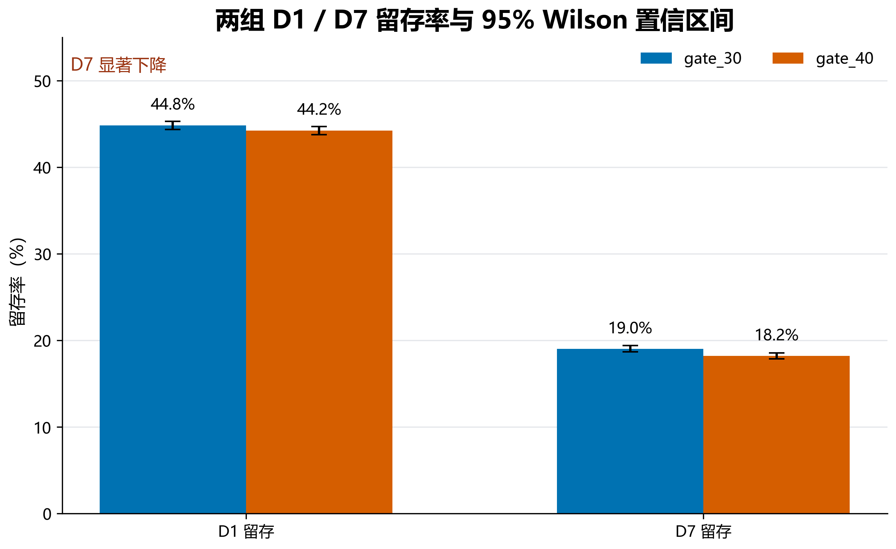
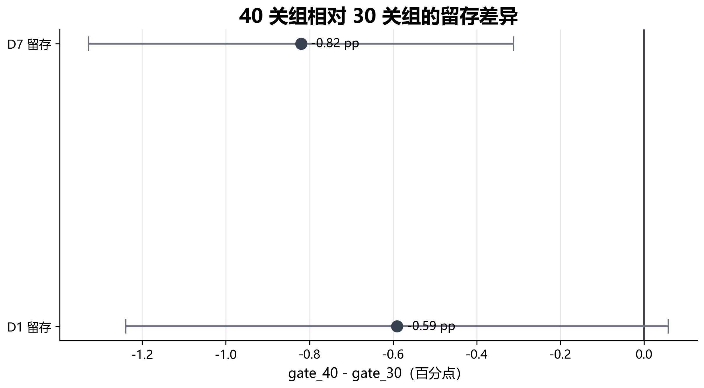
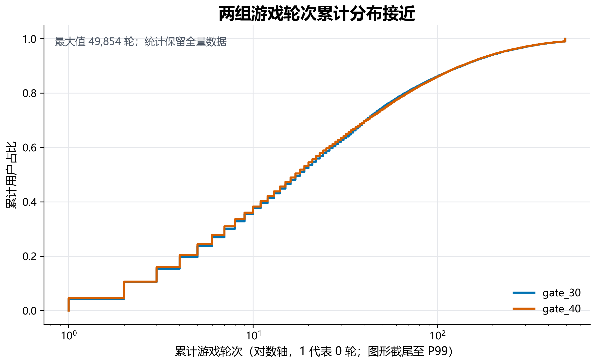
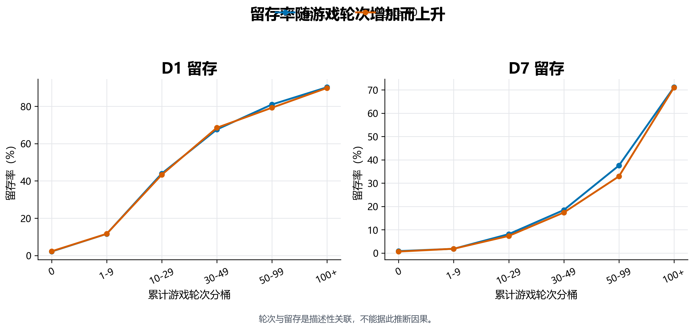

# Cookie Cats 首门槛 A/B 与留存分析

移动游戏在什么时候设置首次等待或付费门槛，会影响新玩家的参与节奏和留存。本项目使用 Cookie Cats 的公开 A/B 实验数据，评估将首次门槛从第 30 关后移到第 40 关，是否改善 D1、D7 留存与游戏轮次。

**结论：建议保留 `gate_30`。** 40 关组的 D7 留存显著低于 30 关组，D1 留存也呈负向变化但没有统计显著性，游戏轮次中位数没有提升。

[查看 5 页 PPTX 汇报](report/AB复盘汇报.pptx) · [查看 PDF 汇报](report/AB复盘汇报.pdf)

## 核心结果

| 指标 | gate_30 | gate_40 | 差异（40 - 30） | 95% CI | p 值 |
|---|---:|---:|---:|---:|---:|
| D1 留存 | 44.82% | 44.23% | -0.59 pp | [-1.24, 0.06] pp | 0.0744 |
| D7 留存 | 19.02% | 18.20% | -0.82 pp | [-1.33, -0.31] pp | 0.00155 |
| 游戏轮次中位数 | 17 | 16 | -1 | 描述统计 | 0.0502* |

\* 游戏轮次使用 Mann-Whitney U 检验，p 值接近 0.05，仅作为辅助信号，不作为主要决策依据。





## 业务判断

主指标设为 D7 留存，辅助指标为 D1 留存与游戏轮次。决策规则在分析前确定：只有 40 关组在 D1、D7 上均未出现显著负向影响，且至少一项核心指标存在正向证据时，才建议上线 40 关。

本次结果不支持上线 40 关：

- D7 留存下降 0.82 个百分点，置信区间完全低于 0，p 值为 0.00155。
- D1 留存下降 0.59 个百分点，未达到 0.05 显著性水平，但方向仍为负。
- 游戏轮次中位数从 17 降至 16，未观察到“让玩家多玩几关”的预期收益。
- 数据缺少付费、ARPU 和长期留存信息，即使留存持平，也不能据此判断收入会改善。

## 数据与口径

- 样本：90,189 名新玩家。
- 分组：`gate_30` 44,700 人，`gate_40` 45,489 人。
- 数据质量：用户 ID 唯一，五个字段均无缺失，分组只包含两种实验版本。
- 原始字段：`userid`、`version`、`sum_gamerounds`、`retention_1`、`retention_7`。
- 留存定义：安装后第 1 天和第 7 天是否再次登录。
- 游戏轮次：数据集记录的累计游戏轮次；最大值 49,854，P99 为 493。

数据来自 DataCamp 的公开项目 **Mobile Games A/B Testing with Cookie Cats**，当前固定镜像：

<https://github.com/thegarrickchu/Mobile-Games-Ab-testing-with-Cookie-Cats>

数据集 SHA-256：

```text
5AB54D761FBDDCD50DE7B88E4EAF7837CBA4569474F50C043A4D17EE342C46BD
```

## 方法

1. 使用 SQL 核对数据质量、分组规模、留存人数和轮次分桶。
2. 使用 Wilson 方法计算各分组留存率的 95% 置信区间。
3. 使用双比例 z 检验比较 `gate_40 - gate_30` 的留存差异，并计算差异的 95% 置信区间。
4. 主分析保留全部游戏轮次；另用 P99 截尾均值做异常值敏感性检查。
5. 使用分桶和累计分布比较两组游戏轮次结构，避免单个极端用户主导结论。





轮次与留存之间是描述性关联。高活跃玩家天然更可能继续登录，不能据此推断“增加局数一定提高留存”。

## 局限

- 数据不包含曝光时间、设备、地区、渠道和付费金额，无法分析 DAU 趋势、ARPU、LTV 或收入影响。
- 分组比例为 49.56% 与 50.44%，SRM 卡方检验 p=0.0086。偏差只有约 0.87 个百分点，但不能据此断言分流完全无问题；报告将其保留为实验设计限制。
- 留存字段是二元结果，无法区分同一天多次登录、会话时长或具体流失节点。
- 本分析只评估公开实验数据，不代表任何真实上线项目的业务表现，也不声称产生真实商业收益。

## 项目结构

```text
.
├── analysis.py
├── data/
│   └── cookie_cats.csv
├── figures/
├── report/
│   ├── AB复盘汇报.pptx
│   ├── AB复盘汇报.pdf
│   ├── analysis_results.json
│   └── results_summary.csv
├── resume/
│   └── project_bullets.md
├── sql/
│   └── analysis.sql
├── tests/
│   └── test_analysis.py
└── requirements.txt
```

## 复现

```powershell
python -m venv --system-site-packages .venv
.\.venv\Scripts\python.exe -m pip install -r requirements.txt
.\.venv\Scripts\python.exe analysis.py
.\.venv\Scripts\python.exe -m unittest discover -s tests -v
```

分析完成后，`report/analysis_results.json` 保存全部指标，`report/results_summary.csv` 保存核心对比结果，`figures/` 会重新生成 PNG、SVG 和 PDF。

## 简历表述

- 基于 Cookie Cats 90,189 名玩家的公开 A/B 实验数据，使用 SQL 与 Python 分析首次付费门槛位置对 D1/D7 留存和游戏轮次的影响。
- 完成分组校验、Wilson 置信区间、双比例检验、异常值敏感性与轮次分群；发现 40 关组 D7 留存下降 0.82 个百分点（p=0.00155），据此建议保留 30 关门槛并补充付费指标验证。

## 作者

XIN6014

